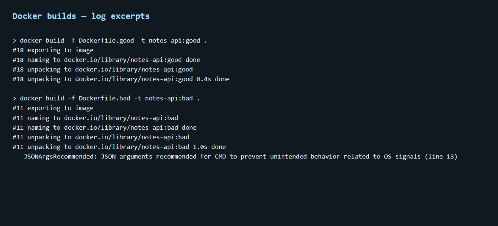

# Notes API — лабораторные по контейнеризации (ITMO)

**Команда:** Firat Karatasoglu, Yahya

| ЛР | Тема | Раздел |
|----|------|--------|
| 1 | Dockerfile | [ЛР 1. Dockerfile](#лр-1-dockerfile) |
| 2 | Docker Compose | [ЛР 2. Docker Compose](#лр-2-docker-compose) |

История изменений — в [CHANGES.md](CHANGES.md).

## Приложение

**Notes API** — небольшой REST-сервис заметок на FastAPI. Хранилище
выбирается переменными окружения:

- **без `DB_HOST`** (ЛР 1) — SQLite-файл в каталоге `/app/data`, который
  монтируется как **volume**;
- **с `DB_HOST`** (ЛР 2) — PostgreSQL в отдельном контейнере, схему БД
  создаёт одноразовый init-сервис.

Эндпоинт `/health` используется в healthcheck и пригодится для
liveness/readiness probe в Kubernetes.

| Метод    | Путь           | Описание                     |
|----------|----------------|------------------------------|
| `GET`    | `/`            | Информация о сервисе и типе хранилища |
| `GET`    | `/health`      | Проверка состояния (в том числе БД) |
| `GET`    | `/notes`       | Список заметок               |
| `POST`   | `/notes`       | Создать заметку `{"text": "..."}` |
| `GET`    | `/notes/{id}`  | Получить заметку             |
| `DELETE` | `/notes/{id}`  | Удалить заметку              |
| `GET`    | `/docs`        | Swagger UI                   |

## Структура репозитория

```
.
├── app/
│   ├── __init__.py
│   ├── main.py          # HTTP API
│   ├── db.py            # доступ к БД: SQLite или PostgreSQL
│   └── migrate.py       # создание схемы БД (init-сервис в ЛР 2)
├── requirements.txt     # зафиксированные версии зависимостей
├── Dockerfile.good      # хороший Dockerfile (ЛР 1, используется в ЛР 2)
├── Dockerfile.bad       # плохой Dockerfile (ЛР 1)
├── docker-compose.yml   # ЛР 2
├── .env                 # переменные окружения для docker compose (ЛР 2)
├── .dockerignore
├── screenshots/
├── CHANGES.md
└── README.md
```

---

# ЛР 1. Dockerfile

## Сборка и запуск (хороший Dockerfile)

```bash
# сборка
docker build -f Dockerfile.good -t notes-api:good .

# создаём именованный volume и запускаем контейнер
docker volume create notes_data
docker run -d --name notes -p 8000:8000 -v notes_data:/app/data notes-api:good
```

Проверка:

```bash
curl -X POST localhost:8000/notes -H 'Content-Type: application/json' -d '{"text":"hello"}'
curl localhost:8000/notes
```

Проверка, что данные живут в volume, а не в контейнере:

```bash
docker rm -f notes
docker run -d --name notes -p 8000:8000 -v notes_data:/app/data notes-api:good
curl localhost:8000/notes   # заметка "hello" на месте
```

Состояние healthcheck:

```bash
docker inspect --format '{{.State.Health.Status}}' notes   # healthy
```

> **Bind mount вместо volume.** Приложение работает от пользователя с
> UID 10001, поэтому при монтировании папки хоста её нужно сделать доступной
> для записи: `mkdir -p data && sudo chown 10001:10001 data`, затем
> `docker run ... -v "$(pwd)/data:/app/data" notes-api:good`.

## Сборка и запуск (плохой Dockerfile)

```bash
docker build -f Dockerfile.bad -t notes-api:bad .
docker volume create notes_data_bad
docker run -d --name notes-bad -p 8001:8000 -v notes_data_bad:/app/data notes-api:bad
```

После запуска откройте Swagger UI по адресу http://localhost:8001/docs.
Порт 8001 позволяет одновременно держать запущенным хороший образ на порту 8000.

```bash
curl --fail-with-body http://localhost:8001/health
curl --fail-with-body -X POST http://localhost:8001/notes \
  -H 'Content-Type: application/json' -d '{"text":"Проверка volume"}'
curl --fail-with-body http://localhost:8001/notes

docker rm -f notes-bad
docker run -d --name notes-bad -p 8001:8000 -v notes_data_bad:/app/data notes-api:bad
curl --fail-with-body http://localhost:8001/notes
```

Последний запрос возвращает ту же заметку из именованного тома. Если
приложение ещё запускается, дождитесь успешного ответа от `/health`.
Для просмотра логов и сравнения размеров образов:

```bash
docker logs notes-bad
docker image ls notes-api
```

### Результаты локальной проверки

Оба образа собраны в Docker Desktop (Linux, amd64). Для каждого образа
`POST /notes` вернул HTTP 201, а `GET /notes` после пересоздания контейнера
с тем же именованным томом вернул ту же заметку и время её создания.
У `notes-api:good` Docker также показал статус `healthy`.

| Образ | Размер на диске | Размер содержимого |
|-------|-----------------|---------------------|
| `notes-api:good` | 226 МБ | 54,5 МБ |
| `notes-api:bad` | 1,79 ГБ | 467 МБ |

По выводу `docker image ls notes-api` плохой образ занял примерно в 7,9 раза
больше места на диске.




## Плохие практики в Dockerfile.bad и их исправление

| # | Плохая практика | Почему это плохо | Как исправлено в Dockerfile.good |
|---|-----------------|------------------|----------------------------------|
| 1 | Полный образ `python:latest` | Тег меняется со временем. Следующая сборка может получить новую версию Python. Полный образ содержит больше системных пакетов. | Указана конкретная версия `python:3.12.8-slim-bookworm` для обоих этапов. |
| 2 | `apt-get update` и установка пакетов в разных слоях | При изменении списка пакетов Docker может переиспользовать слой с устаревшими индексами. Очистка в позднем слое не уменьшила бы размер раннего слоя. | Базового slim-образа хватает, поэтому вызовов APT и сохранённых индексов нет. |
| 3 | Установка `vim`, `nano` и `curl`, сохранение кэшей APT и pip | Редакторы, сетевой клиент и кэши увеличивают размер образа. Сервису они не нужны. | Лишние пакеты не ставятся, pip работает с `PIP_NO_CACHE_DIR=1`, в финальный образ переносится готовый venv. |
| 4 | `COPY . .` до установки зависимостей | Изменение любого файла, попавшего в контекст, сбрасывает кэш слоя установки. Копирование всего контекста также приносит файлы, которые могут быть лишними при запуске. | Сначала копируется `requirements.txt` и ставятся зависимости. В финальный образ отдельно копируются venv и `app/`. |
| 5 | Запуск с унаследованным пользователем root | У процесса больше прав внутри контейнера. При уязвимости приложения расширяется набор доступных атакующему действий. | `USER app` задаёт UID 10001. Пользователю приложения принадлежит каталог данных. |
| 6 | Shell-форма `CMD` | Процесс `/bin/sh` занимает PID 1 и может не передать сигнал остановки uvicorn. | Exec-форма `CMD` запускает uvicorn напрямую, поэтому сервер получает `SIGTERM`. |
| 7 | Нет `HEALTHCHECK` | Docker видит запущенный процесс, даже если HTTP-сервис перестал отвечать. | `HEALTHCHECK` периодически проверяет `/health` и отражает результат в статусе контейнера. |

### Что сделано в Dockerfile.good

- **Фиксированная версия slim-образа** (`python:3.12.8-slim-bookworm`) вместо
  `latest`: сборка воспроизводима, образ меньше и содержит меньше уязвимостей.
- **Multi-stage build**: зависимости ставятся в stage `builder`, в финальный
  образ копируется только готовый venv — без pip-кэша и лишних инструментов.
- **Правильный порядок слоёв**: сначала копируется `requirements.txt` и ставятся
  зависимости, и только потом код. При изменении кода слой с зависимостями
  берётся из кэша, и пересборка занимает секунды.
- **Зафиксированные версии зависимостей** в `requirements.txt`.
- **`.dockerignore`**: в контекст сборки и образ не попадают `.git`, локальные
  данные, кэш Python, документация.
- **Непривилегированный пользователь** (`USER app`, UID 10001): при уязвимости
  в приложении злоумышленник не получает root в контейнере. Код принадлежит
  root и доступен приложению только на чтение, писать можно только в `/app/data`.
- **Без кэша pip** (`PIP_NO_CACHE_DIR=1`) и без лишних системных пакетов.
- **`HEALTHCHECK`**: Docker сам отслеживает, жив ли сервис.
- **exec-форма `CMD`**: uvicorn работает как PID 1 и корректно получает
  `SIGTERM` при `docker stop`, а не убивается через 10 секунд по `SIGKILL`.
- **`PYTHONUNBUFFERED=1`**: логи сразу попадают в `docker logs`.
- **Данные вынесены в volume** (`/app/data`), путь задаётся через `DATA_DIR`.

## Плохие практики при использовании контейнера

1. **Хранить SQLite в слое контейнера.** Если запустить Notes API без тома
   на `/app/data`, при удалении контейнера исчезнет и база заметок. Подключайте
   именованный том и сохраняйте его при пересоздании контейнера.
2. **Монтировать сокет Docker в контейнер.** Notes API работает с SQLite
   и не управляет другими контейнерами. Доступ к `/var/run/docker.sock`
   даёт процессу возможность обращаться к демону Docker и управлять хостом.

## Когда НЕ стоит использовать контейнеры

1. **Нужно другое ядро ОС.** Например, для тестирования драйвера Windows
   на хосте Linux нужна виртуальная машина с ядром Windows. Обычный Linux-контейнер
   использует ядро Linux.
2. **Нужны гарантированные жёсткие сроки реакции.** Например, для аварийного
   отключения промышленной установки используют выделенный контроллер с ОС
   реального времени. Обычный Docker-контейнер на ОС общего назначения
   разделяет планировщик с другими процессами, поэтому сам по себе таких гарантий не даёт.

---

# ЛР 2. Docker Compose

Compose-проект из трёх сервисов на основе `Dockerfile.good` из ЛР 1:

| Сервис | Контейнер | Роль |
|--------|-----------|------|
| `db` | `notes-db` | PostgreSQL 16, данные в именованном volume `notes-pgdata` |
| `migrate` | `notes-migrate` | **init-сервис**: один раз создаёт схему БД и завершается с кодом 0 |
| `app` | `notes-api` | Notes API, порт 8000 проброшен наружу |

Порядок запуска: `db` становится `healthy` → `migrate` отрабатывает и
завершается → стартует `app`.

## Запуск

```bash
docker compose up -d --build
docker compose ps -a
```

Ожидаемый результат:

```
NAME            IMAGE                  STATUS                      PORTS
notes-api       notes-api:2.0.0        Up 20 seconds (healthy)     0.0.0.0:8000->8000/tcp
notes-db        postgres:16.6-alpine   Up 30 seconds (healthy)     5432/tcp
notes-migrate   notes-api:2.0.0        Exited (0) 20 seconds ago
```

Проверка:

```bash
docker logs notes-migrate
# [migrate] backend: postgres
# [migrate] schema is up to date, notes in table: 0

curl localhost:8000/
# {"service":"notes-api","version":"2.0.0","storage":"postgres","docs":"/docs"}

curl -X POST localhost:8000/notes -H 'Content-Type: application/json' -d '{"text":"compose + postgres"}'
curl localhost:8000/notes
```

Данные хранятся в volume, поэтому переживают `docker compose down`:

```bash
docker compose down
docker compose up -d
curl localhost:8000/notes   # заметка на месте
```

Полная очистка вместе с данными: `docker compose down -v`.

> Файл `.env` лежит в репозитории, потому что этого требует задание.
> В реальном проекте в git хранят только `.env.example` с примерами значений,
> а настоящий `.env` добавляют в `.gitignore`. В образ `.env` не попадает:
> он указан в `.dockerignore`.

### Результаты локальной проверки

Compose-проект собран и запущен на Windows 11 (Docker Desktop, Linux-контейнеры,
Docker Engine 29.8.2). Результат: `notes-db` и `notes-api` — `healthy`,
`notes-migrate` — `Exited (0)`. `POST /notes` вернул HTTP 201, `GET /notes` —
созданную заметку. Заметка, созданная до `docker compose down`, осталась в
именованном томе `notes-pgdata` и видна после повторного `docker compose up`
(в выводе `GET /notes` на скриншоте видны обе заметки, а `migrate` сообщает
`notes in table: 1` — схема уже была создана ранее).


## Описание docker-compose.yml

Верхнеуровневый ключ `name: notes` задаёт имя проекта. Оно подставляется в имена
создаваемых объектов и позволяет не зависеть от имени каталога, в котором лежит
`docker-compose.yml`.

### Якорь `x-notes-image`

```yaml
x-notes-image: &notes-image
  build:
    context: .
    dockerfile: Dockerfile.good
  image: notes-api:2.0.0
  env_file: .env
  networks:
    - notes-net
```

Ключи верхнего уровня, которые начинаются с `x-`, — это *extension fields*.
Compose их не считает сервисами и не пытается запускать, поэтому в них удобно
хранить общий кусок конфигурации.

`&notes-image` — это **якорь** YAML, а `<<: *notes-image` в сервисах `migrate` и
`app` — **слияние** (merge) этого блока в сервис. Так общие настройки записаны
один раз, а не продублированы дважды: оба сервиса собираются из одного и того же
`Dockerfile.good`, получают один и тот же тег образа `notes-api:2.0.0`, один и
тот же `.env` и одну и ту же сеть. Образ при этом собирается **один раз**:
второй сервис видит, что образ с таким тегом уже собран, и переиспользует его.
Если якорь понадобится переопределить, достаточно дописать нужный ключ прямо в
сервисе — значение из сервиса побеждает значение из якоря.

### Сервис `db` — PostgreSQL

| Ключ | Значение и зачем он нужен |
|------|---------------------------|
| `image: postgres:16.6-alpine` | Готовый официальный образ. Тег зафиксирован до патч-версии, а не `latest`, поэтому сборка воспроизводима. Вариант `alpine` меньше по размеру. |
| `container_name: notes-db` | Фиксированное имя контейнера вместо автогенерируемого `notes-db-1`. Удобно для `docker logs notes-db`, `docker exec -it notes-db psql`. Обратная сторона: имя должно быть уникальным на хосте и сервис нельзя масштабировать через `--scale`. |
| `env_file: .env` | Переменные берутся из файла, а не хардкодятся в YAML. Отсюда образ `postgres` получает `POSTGRES_DB`, `POSTGRES_USER`, `POSTGRES_PASSWORD` и при первом запуске создаёт базу и пользователя. |
| `volumes: - pgdata:/var/lib/postgresql/data` | Каталог с данными PostgreSQL вынесен в **именованный том**. Контейнер можно удалить и пересоздать — данные останутся. |
| `networks: - notes-net` | Сервис подключён к нашей пользовательской сети. |
| `healthcheck` | `pg_isready -U $${POSTGRES_USER} -d $${POSTGRES_DB}` раз в 5 с, таймаут 3 с, 10 попыток, `start_period: 10s` (первые 10 с неудачи не считаются). Пока проверка не прошла, статус контейнера — `health: starting`, потом `healthy`. Именно на этот статус опираются `depends_on` у `migrate` и `app`. Двойной знак `$$` нужен, чтобы Compose **не** подставлял переменную сам, а передал строку `$POSTGRES_USER` внутрь контейнера — там её раскроет shell. |
| `restart: unless-stopped` | Контейнер перезапускается при падении и после перезагрузки демона, но остаётся остановленным, если его остановили вручную. |

Порт `5432` наружу **не публикуется**: база доступна только внутри сети
`notes-net`. Это сознательное решение — наружу торчит только API.

### Сервис `migrate` — одноразовый init-сервис

| Ключ | Значение и зачем он нужен |
|------|---------------------------|
| `<<: *notes-image` | Подставляет `build`, `image`, `env_file`, `networks` из якоря. |
| `build.context: .` + `build.dockerfile: Dockerfile.good` | Образ собирается из исходников репозитория «хорошим» Dockerfile из ЛР 1 (multi-stage, непривилегированный пользователь, exec-форма CMD). |
| `image: notes-api:2.0.0` | Имя и тег, под которым сохраняется собранный образ. Если образ с таким тегом уже есть, Compose не собирает его заново без `--build`. |
| `container_name: notes-migrate` | Предсказуемое имя для `docker logs notes-migrate`. |
| `command: ["python", "-m", "app.migrate"]` | Переопределяет `CMD` из образа: вместо uvicorn запускается миграция. Exec-форма (список), поэтому процесс получает PID 1 и корректно принимает сигналы. |
| `depends_on: db: condition: service_healthy` | Миграция стартует только после того, как база **готова принимать соединения**, а не просто «контейнер запущен». |
| `healthcheck: disable: true` | Отключает `HEALTHCHECK`, унаследованный из `Dockerfile.good`. Он проверяет HTTP-эндпоинт `/health`, которого у миграции нет, и контейнер, который сразу завершается, всё равно считался бы `unhealthy`. |
| `restart: "no"` | Обязательно для init-сервиса: иначе Docker бесконечно перезапускал бы контейнер, который нормально завершился с кодом 0. |

После успешной работы контейнер остаётся в состоянии `Exited (0)` — это и есть
признак, которого ждёт сервис `app`.

### Сервис `app` — Notes API

| Ключ | Значение и зачем он нужен |
|------|---------------------------|
| `<<: *notes-image` | Те же `build`, `image`, `env_file`, `networks`. Образ уже собран сервисом `migrate`, поэтому повторной сборки не происходит. |
| `container_name: notes-api` | Фиксированное имя контейнера. |
| `command: ["uvicorn", "app.main:app", "--host", "0.0.0.0", "--port", "8000"]` | Явно повторяет `CMD` образа. Важно `--host 0.0.0.0`: иначе uvicorn слушал бы только loopback внутри контейнера и проброс порта не работал бы. |
| `ports: - "${APP_PORT}:8000"` | Публикация порта наружу: слева порт хоста (из `.env`, по умолчанию 8000), справа порт внутри контейнера. Только у этого сервиса есть доступ снаружи. |
| `depends_on: db: service_healthy` | API не стартует, пока база не `healthy`. |
| `depends_on: migrate: service_completed_successfully` | API не стартует, пока миграция не завершится **успешно** (код выхода 0). Если миграция упадёт, `app` не запустится вообще — это защищает от работы приложения на несозданной схеме. |
| `healthcheck` | HTTP-проверка `/health` средствами самого Python (`urllib.request`) раз в 15 с. Внешние утилиты вроде `curl` в «хорошем» образе не ставятся, поэтому проверка написана на том, что уже есть. |
| `deploy.resources.limits` | Жёсткие лимиты: `cpus: "0.50"` и `memory: 256M`. Подробнее — в ответе на вопрос ниже. |
| `restart: unless-stopped` | Автоперезапуск API при падении. |

#### Разница условий в `depends_on`

| Условие | Когда зависимый сервис начинает запускаться |
|---------|---------------------------------------------|
| `service_started` | Сразу после того, как контейнер зависимости **запущен**. Это поведение по умолчанию для короткой формы `depends_on: [db]`. Готовность процесса внутри контейнера не проверяется. |
| `service_healthy` | Когда `healthcheck` зависимости впервые вернул `healthy`. Используем для `db`. |
| `service_completed_successfully` | Когда контейнер зависимости **завершился** с кодом выхода 0. Используем для `migrate`. |

Без `service_healthy` приложение почти наверняка упало бы на старте: контейнер
PostgreSQL поднимается за доли секунды, а сам сервер готов принимать соединения
на несколько секунд позже.

### `networks`

```yaml
networks:
  notes-net:
    name: notes-net
    driver: bridge
```

Своя пользовательская bridge-сеть. Внутри неё работает встроенный DNS Docker:
контейнеры видят друг друга **по именам сервисов**, поэтому в `.env` указано
`DB_HOST=db`, а не IP-адрес. Ключ `name` задаёт точное имя сети — без него
Compose назвал бы её `notes_notes-net`. Если бы блока `networks` не было вовсе,
Compose всё равно создал бы сеть `notes_default`; здесь она объявлена явно, чтобы
имя было предсказуемым.

### `volumes`

```yaml
volumes:
  pgdata:
    name: notes-pgdata
```

Объявление именованного тома, который монтируется в `db`. Данными управляет сам
Docker (на Windows том лежит внутри ВМ Docker Desktop), поэтому прав доступа к
хостовой файловой системе касаться не нужно. Том переживает `docker compose down`
и удаляется только явной командой `docker compose down -v`.

## Ответы на вопросы

### Можно ли ограничивать ресурсы (память, CPU) для сервисов в docker-compose.yml?

Да, можно. Актуальный способ — секция `deploy.resources`:

```yaml
deploy:
  resources:
    limits:        # жёсткий потолок
      cpus: "0.50"
      memory: 256M
    reservations:  # мягкая «бронь» ресурсов
      cpus: "0.10"
      memory: 64M
```

`limits` — это верхняя граница, которую контейнер не сможет превысить:
`cpus: "0.50"` означает половину ядра, `memory: 256M` — 256 МиБ ОЗУ (при
превышении процесс убивает OOM-killer). `reservations` — наоборот, нижняя
граница: сколько ресурсов планировщик обязан оставить сервису.

Важная деталь: исторически блок `deploy` относился к Docker Swarm, и старый
`docker-compose` v1 его игнорировал. В Docker Compose v2 (`docker compose`,
которым мы и пользуемся) `deploy.resources.limits` применяется и при обычном
`up`. Старые ключи-аналоги тоже поддерживаются: `mem_limit`, `cpus`,
`memswap_limit`, `pids_limit`.

В нашем файле лимиты заданы сервису `app`. Проверяем, что они действительно
применились к контейнеру:

```powershell
docker inspect notes-api --format "NanoCpus={{.HostConfig.NanoCpus}}  Memory={{.HostConfig.Memory}}"
# NanoCpus=500000000  Memory=268435456
```

`500000000` нано-CPU = 0,5 ядра, `268435456` байт = 256 МиБ — ровно то, что
записано в `docker-compose.yml`. То же видно и в `docker stats`:

```powershell
docker stats notes-api --no-stream --format "{{.Name}} CPU={{.CPUPerc}} MEM={{.MemUsage}} ({{.MemPerc}})"
# notes-api CPU=0.14% MEM=43.02MiB / 256MiB (16.81%)
```

Знаменатель `256MiB` — это и есть лимит, а не объём памяти хоста. Вывод
`docker inspect` виден и на скриншоте
[`lab2-compose-ps.png`](screenshots/lab2-compose-ps.png).

### Как запустить только определённый сервис из docker-compose.yml?

Достаточно указать имя сервиса в команде:

```bash
docker compose up -d db
```

По умолчанию Compose поднимет не только сам сервис, но и всё, от чего он зависит
по `depends_on`. Чтобы запустить сервис **без зависимостей**, добавляется
`--no-deps`:

```bash
docker compose up -d --no-deps app
```

Другие полезные варианты:

| Команда | Что делает |
|---------|------------|
| `docker compose up -d db` | Поднимает сервис вместе с его зависимостями. |
| `docker compose up -d --no-deps app` | Поднимает только указанный сервис. Удобно, когда БД уже работает и нужно перевыкатить одно приложение (`--build` пересоберёт только его образ). |
| `docker compose run --rm [--no-deps] app <команда>` | Разовый запуск команды в новом контейнере сервиса. Порты из `ports` при этом не публикуются, а `--rm` удаляет контейнер после выхода. |
| `docker compose stop app` / `docker compose start app` | Остановить/запустить один уже созданный контейнер. |
| `profiles: ["debug"]` у сервиса | Сервис не запускается при обычном `up` и поднимается только с `--profile debug`. Так исключают из обычного запуска отладочные и вспомогательные сервисы. |

Проверено на нашем проекте — поднимаем только базу:

```powershell
PS C:\Masaüstü\itmo-lab> docker compose up -d --no-deps db
 Network notes-net  Created
 Container notes-db  Created
 Container notes-db  Started

PS C:\Masaüstü\itmo-lab> docker compose ps -a
NAME       IMAGE                  COMMAND                  SERVICE   CREATED        STATUS                                     PORTS
notes-db   postgres:16.6-alpine   "docker-entrypoint.s…"   db        1 second ago   Up Less than a second (health: starting)   5432/tcp
```

Контейнеров `notes-migrate` и `notes-api` в списке нет — запустился ровно один
сервис. И разовая команда в контейнере приложения, тоже без зависимостей:

```powershell
PS C:\Masaüstü\itmo-lab> docker compose run --rm --no-deps app python -c "print('one-off command, no app container started')"
 Container notes-app-run-58ab7ff11cc3  Created
one-off command, no app container started
```
