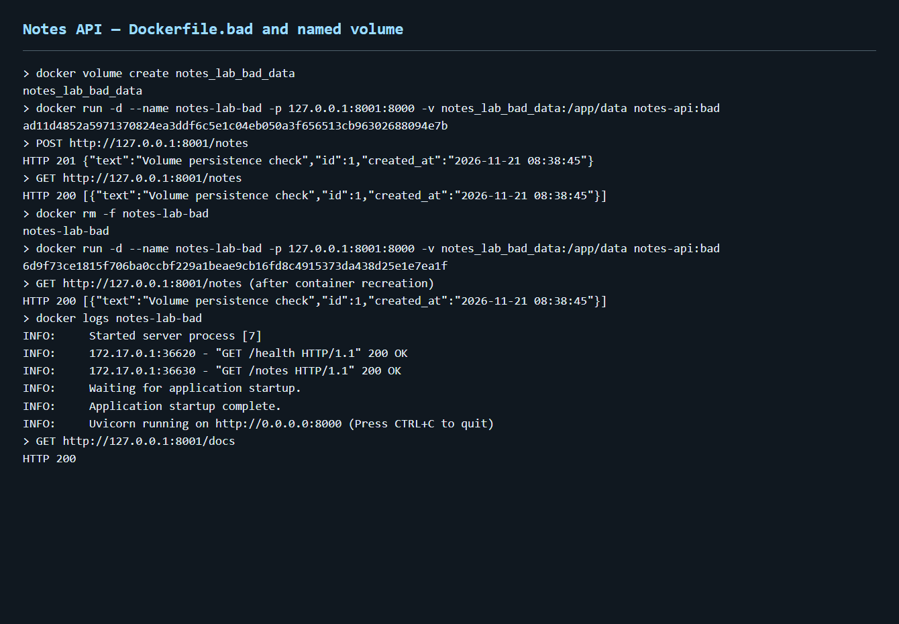

# Notes API — лабораторные по контейнеризации (ITMO)

**Команда:** Firat Karatasoglu, Yahya

| ЛР | Тема | Раздел |
|----|------|--------|
| 1 | Dockerfile | [ЛР 1. Dockerfile](#лр-1-dockerfile) |
| 2 | Docker Compose | [ЛР 2. Docker Compose](#лр-2-docker-compose) |

История изменений — в [CHANGES.md](CHANGES.md).

## Приложение

**Notes API** — небольшой REST-сервис заметок на FastAPI. Хранилище
выбирается переменными окружения:

- **без `DB_HOST`** (ЛР 1) — SQLite-файл в каталоге `/app/data`, который
  монтируется как **volume**;
- **с `DB_HOST`** (ЛР 2) — PostgreSQL в отдельном контейнере, схему БД
  создаёт одноразовый init-сервис.

Эндпоинт `/health` используется в healthcheck и пригодится для
liveness/readiness probe в Kubernetes.

| Метод    | Путь           | Описание                     |
|----------|----------------|------------------------------|
| `GET`    | `/`            | Информация о сервисе и типе хранилища |
| `GET`    | `/health`      | Проверка состояния (в том числе БД) |
| `GET`    | `/notes`       | Список заметок               |
| `POST`   | `/notes`       | Создать заметку `{"text": "..."}` |
| `GET`    | `/notes/{id}`  | Получить заметку             |
| `DELETE` | `/notes/{id}`  | Удалить заметку              |
| `GET`    | `/docs`        | Swagger UI                   |

## Структура репозитория

```
.
├── app/
│   ├── __init__.py
│   ├── main.py          # HTTP API
│   ├── db.py            # доступ к БД: SQLite или PostgreSQL
│   └── migrate.py       # создание схемы БД (init-сервис в ЛР 2)
├── requirements.txt     # зафиксированные версии зависимостей
├── Dockerfile.good      # хороший Dockerfile (ЛР 1, используется в ЛР 2)
├── Dockerfile.bad       # плохой Dockerfile (ЛР 1)
├── docker-compose.yml   # ЛР 2
├── .env                 # переменные окружения для docker compose (ЛР 2)
├── .dockerignore
├── screenshots/
├── CHANGES.md
└── README.md
```

---

# ЛР 1. Dockerfile

## Сборка и запуск (хороший Dockerfile)

```bash
# сборка
docker build -f Dockerfile.good -t notes-api:good .

# создаём именованный volume и запускаем контейнер
docker volume create notes_data
docker run -d --name notes -p 8000:8000 -v notes_data:/app/data notes-api:good
```

Проверка:

```bash
curl -X POST localhost:8000/notes -H 'Content-Type: application/json' -d '{"text":"hello"}'
curl localhost:8000/notes
```

Проверка, что данные живут в volume, а не в контейнере:

```bash
docker rm -f notes
docker run -d --name notes -p 8000:8000 -v notes_data:/app/data notes-api:good
curl localhost:8000/notes   # заметка "hello" на месте
```

Состояние healthcheck:

```bash
docker inspect --format '{{.State.Health.Status}}' notes   # healthy
```

> **Bind mount вместо volume.** Приложение работает от пользователя с
> UID 10001, поэтому при монтировании папки хоста её нужно сделать доступной
> для записи: `mkdir -p data && sudo chown 10001:10001 data`, затем
> `docker run ... -v "$(pwd)/data:/app/data" notes-api:good`.

## Сборка и запуск (плохой Dockerfile)

```bash
docker build -f Dockerfile.bad -t notes-api:bad .
docker volume create notes_data_bad
docker run -d --name notes-bad -p 8001:8000 -v notes_data_bad:/app/data notes-api:bad
```

После запуска откройте Swagger UI по адресу http://localhost:8001/docs.
Порт 8001 позволяет одновременно держать запущенным хороший образ на порту 8000.

```bash
curl --fail-with-body http://localhost:8001/health
curl --fail-with-body -X POST http://localhost:8001/notes \
  -H 'Content-Type: application/json' -d '{"text":"Проверка volume"}'
curl --fail-with-body http://localhost:8001/notes

docker rm -f notes-bad
docker run -d --name notes-bad -p 8001:8000 -v notes_data_bad:/app/data notes-api:bad
curl --fail-with-body http://localhost:8001/notes
```

Последний запрос возвращает ту же заметку из именованного тома. Если
приложение ещё запускается, дождитесь успешного ответа от `/health`.
Для просмотра логов и сравнения размеров образов:

```bash
docker logs notes-bad
docker image ls notes-api
```

### Результаты локальной проверки

Оба образа собраны в Docker Desktop (Linux, amd64). Для каждого образа
`POST /notes` вернул HTTP 201, а `GET /notes` после пересоздания контейнера
с тем же именованным томом вернул ту же заметку и время её создания.
У `notes-api:good` Docker также показал статус `healthy`.

| Образ | Размер на диске | Размер содержимого |
|-------|-----------------|---------------------|
| `notes-api:good` | 226 МБ | 54,5 МБ |
| `notes-api:bad` | 1,79 ГБ | 467 МБ |

По выводу `docker image ls notes-api` плохой образ занял примерно в 7,9 раза
больше места на диске.





## Плохие практики в Dockerfile.bad и их исправление

| # | Плохая практика | Почему это плохо | Как исправлено в Dockerfile.good |
|---|-----------------|------------------|----------------------------------|
| 1 | Полный образ `python:latest` | Тег меняется со временем. Следующая сборка может получить новую версию Python. Полный образ содержит больше системных пакетов. | Указана конкретная версия `python:3.12.8-slim-bookworm` для обоих этапов. |
| 2 | `apt-get update` и установка пакетов в разных слоях | При изменении списка пакетов Docker может переиспользовать слой с устаревшими индексами. Очистка в позднем слое не уменьшила бы размер раннего слоя. | Базового slim-образа хватает, поэтому вызовов APT и сохранённых индексов нет. |
| 3 | Установка `vim`, `nano` и `curl`, сохранение кэшей APT и pip | Редакторы, сетевой клиент и кэши увеличивают размер образа. Сервису они не нужны. | Лишние пакеты не ставятся, pip работает с `PIP_NO_CACHE_DIR=1`, в финальный образ переносится готовый venv. |
| 4 | `COPY . .` до установки зависимостей | Изменение любого файла, попавшего в контекст, сбрасывает кэш слоя установки. Копирование всего контекста также приносит файлы, которые могут быть лишними при запуске. | Сначала копируется `requirements.txt` и ставятся зависимости. В финальный образ отдельно копируются venv и `app/`. |
| 5 | Запуск с унаследованным пользователем root | У процесса больше прав внутри контейнера. При уязвимости приложения расширяется набор доступных атакующему действий. | `USER app` задаёт UID 10001. Пользователю приложения принадлежит каталог данных. |
| 6 | Shell-форма `CMD` | Процесс `/bin/sh` занимает PID 1 и может не передать сигнал остановки uvicorn. | Exec-форма `CMD` запускает uvicorn напрямую, поэтому сервер получает `SIGTERM`. |
| 7 | Нет `HEALTHCHECK` | Docker видит запущенный процесс, даже если HTTP-сервис перестал отвечать. | `HEALTHCHECK` периодически проверяет `/health` и отражает результат в статусе контейнера. |

### Что сделано в Dockerfile.good

- **Фиксированная версия slim-образа** (`python:3.12.8-slim-bookworm`) вместо
  `latest`: сборка воспроизводима, образ меньше и содержит меньше уязвимостей.
- **Multi-stage build**: зависимости ставятся в stage `builder`, в финальный
  образ копируется только готовый venv — без pip-кэша и лишних инструментов.
- **Правильный порядок слоёв**: сначала копируется `requirements.txt` и ставятся
  зависимости, и только потом код. При изменении кода слой с зависимостями
  берётся из кэша, и пересборка занимает секунды.
- **Зафиксированные версии зависимостей** в `requirements.txt`.
- **`.dockerignore`**: в контекст сборки и образ не попадают `.git`, локальные
  данные, кэш Python, документация.
- **Непривилегированный пользователь** (`USER app`, UID 10001): при уязвимости
  в приложении злоумышленник не получает root в контейнере. Код принадлежит
  root и доступен приложению только на чтение, писать можно только в `/app/data`.
- **Без кэша pip** (`PIP_NO_CACHE_DIR=1`) и без лишних системных пакетов.
- **`HEALTHCHECK`**: Docker сам отслеживает, жив ли сервис.
- **exec-форма `CMD`**: uvicorn работает как PID 1 и корректно получает
  `SIGTERM` при `docker stop`, а не убивается через 10 секунд по `SIGKILL`.
- **`PYTHONUNBUFFERED=1`**: логи сразу попадают в `docker logs`.
- **Данные вынесены в volume** (`/app/data`), путь задаётся через `DATA_DIR`.

## Плохие практики при использовании контейнера

1. **Хранить SQLite в слое контейнера.** Если запустить Notes API без тома
   на `/app/data`, при удалении контейнера исчезнет и база заметок. Подключайте
   именованный том и сохраняйте его при пересоздании контейнера.
2. **Монтировать сокет Docker в контейнер.** Notes API работает с SQLite
   и не управляет другими контейнерами. Доступ к `/var/run/docker.sock`
   даёт процессу возможность обращаться к демону Docker и управлять хостом.

## Когда НЕ стоит использовать контейнеры

1. **Нужно другое ядро ОС.** Например, для тестирования драйвера Windows
   на хосте Linux нужна виртуальная машина с ядром Windows. Обычный Linux-контейнер
   использует ядро Linux.
2. **Нужны гарантированные жёсткие сроки реакции.** Например, для аварийного
   отключения промышленной установки используют выделенный контроллер с ОС
   реального времени. Обычный Docker-контейнер на ОС общего назначения
   разделяет планировщик с другими процессами, поэтому сам по себе таких гарантий не даёт.

---

# ЛР 2. Docker Compose

Compose-проект из трёх сервисов на основе `Dockerfile.good` из ЛР 1:

| Сервис | Контейнер | Роль |
|--------|-----------|------|
| `db` | `notes-db` | PostgreSQL 16, данные в именованном volume `notes-pgdata` |
| `migrate` | `notes-migrate` | **init-сервис**: один раз создаёт схему БД и завершается с кодом 0 |
| `app` | `notes-api` | Notes API, порт 8000 проброшен наружу |

Порядок запуска: `db` становится `healthy` → `migrate` отрабатывает и
завершается → стартует `app`.

## Запуск

```bash
docker compose up -d --build
docker compose ps -a
```

Ожидаемый результат:

```
NAME            IMAGE                  STATUS                      PORTS
notes-api       notes-api:2.0.0        Up 20 seconds (healthy)     0.0.0.0:8000->8000/tcp
notes-db        postgres:16.6-alpine   Up 30 seconds (healthy)     5432/tcp
notes-migrate   notes-api:2.0.0        Exited (0) 20 seconds ago
```

Проверка:

```bash
docker logs notes-migrate
# [migrate] backend: postgres
# [migrate] schema is up to date, notes in table: 0

curl localhost:8000/
# {"service":"notes-api","version":"2.0.0","storage":"postgres","docs":"/docs"}

curl -X POST localhost:8000/notes -H 'Content-Type: application/json' -d '{"text":"compose + postgres"}'
curl localhost:8000/notes
```

Данные хранятся в volume, поэтому переживают `docker compose down`:

```bash
docker compose down
docker compose up -d
curl localhost:8000/notes   # заметка на месте
```

Полная очистка вместе с данными: `docker compose down -v`.

> Файл `.env` лежит в репозитории, потому что этого требует задание.
> В реальном проекте в git хранят только `.env.example` с примерами значений,
> а настоящий `.env` добавляют в `.gitignore`. В образ `.env` не попадает:
> он указан в `.dockerignore`.

## Описание docker-compose.yml

<!-- TODO (Яхья): описать каждый сервис и ключ compose-файла
     (build + image, container_name, depends_on с condition, volumes, ports,
     command, healthcheck, env_file, networks, deploy.resources, restart) -->

## Ответы на вопросы

### Можно ли ограничивать ресурсы (память, CPU) для сервисов в docker-compose.yml?

<!-- TODO (Яхья) -->

### Как запустить только определённый сервис из docker-compose.yml?

<!-- TODO (Яхья) -->
